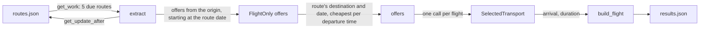

# spies.dk flight scraper

A scraper for direct, one-way flights sold on [spies.dk](https://www.spies.dk). Python and API calls only, no browser automation.

It maps 1,242 routes (origin, destination, date) across 46 airport pairs and keeps a refresh schedule for each one. `result/results.json` holds 62 flights scraped from 60 of those routes. The only runtime dependency is `requests`.

## Project structure

```
src/scraper.py          discovery, work queue, extraction and CLI, all in one file
tests/test_scraper.py   20 unit tests, no network needed
result/routes.json      every route and when it should be refreshed
result/results.json     scraped flights
Dockerfile
requirements.txt        runtime (requests)
requirements-dev.txt    adds pytest
```

I kept the code in a single file. It is about 320 lines and the four functions from the task (`get_work`, `get_update_after`, `extract`, `main`) are easy to follow top to bottom next to a few helpers.

## Finding the data source

I started by looking for an API instead of parsing HTML.

1. The home page loads a booking widget from `bookingstart.nltg.com`, but that API is for packages and charter trips. It returned nothing useful for plain flights.
2. The "one-way flights" page (`/flyrejser/enkeltbilletter`) lists flights with airline, time and price. Its JS bundle contains the GraphQL queries the page runs: `InitialFlightOffers`, `LoadMoreFlightOffers`, `SelectedTransport` and `meta`.
3. In DevTools I searched the Network responses for an airline name shown on the page ("Sunclass"). That led to `POST https://origo-sc.nltg.com/`, which needs no cookie or token, only the headers the site itself sends.
4. GraphQL introspection is disabled, so I stuck to fields the site's own queries use. The one exception was the trip type: the server's validation error suggested `FlightOnly` when I sent a wrong value.

## Mapping the routes

A route is an origin airport, a destination airport and a departure date. `discover_routes()` builds the list like this:

1. For each Danish departure airport (CPH, AAL, AAR, BLL, RNN, HAM, KRP, ODE, SGD) it requests all `FlightOnly` offers.
2. It follows the pagination key (50 offers per page) until the API stops returning one.
3. It keeps the unique `(origin, destination, date)` combinations. The same flight shows up many times because each offer is a package with a different return date.
4. It writes `routes.json`. Routes that already existed keep their timestamps, so rediscovering doesn't reset the schedule. New routes are due immediately.
5. The list is shuffled, otherwise the first batches would all be one origin in date order.

That gives 1,242 routes: CPH 705, BLL 377, AAL 145, RNN 10, ODE 5. The other four origins have no flights at the moment.

```json
{
  "origin": "AAL",
  "destination": "LPA",
  "date": "2027-09-29",
  "last_updated": "2026-11-07T00:46:31+00:00",
  "update_after": "2026-11-08T03:08:29+00:00"
}
```

## Getting the flights



`extract(route)` asks for the origin's offers starting at the route's date. Offers come sorted by date, so it stops as soon as it sees a later day. From what is left it keeps the route's destination and, when a flight appears in several packages, the cheapest one. It then calls `SelectedTransport` once per flight to get the legs, and `build_flight` maps the result to the required format. Flights with more than one leg are dropped. Finally the route's old flights in `results.json` are replaced (a sold-out route ends up with none) and its timestamps are updated.

| Field | Source |
|---|---|
| `departure` | offer's departure day and time |
| `arrival` | destination clock time from the leg. It is in the destination's timezone, so the date is the day that lands closest to `departure + duration` |
| `duration` | leg's duration, in hours |
| `carrier` | carrier key (`flight\|DK` becomes `DK`). The API returns Jettime as `JTD`, which I map to `JP`. Airseven has no IATA code, so it is `null` |
| `iata_origin`, `iata_destination` | offer's airport codes |
| `price` | cheapest package price for one adult, converted from DKK to EUR |
| `stops`, `layover_info`, `vehicle_type` | `0`, `null`, `"aircraft"` |
| `flight_numbers` | `null`, the API doesn't expose it |

The DKK to EUR rate comes from [Frankfurter](https://frankfurter.dev) once per run. If it is unreachable, the code falls back to 1 EUR = 7.46 DKK, since the krone is pegged to the euro.

## Refresh schedule

`get_work()` returns the 5 routes whose `update_after` is in the past, oldest first.

`get_update_after()` decides when a route is refreshed next, based on how close the flight is:

| Days until departure | Refresh after |
|---|---|
| up to 7 | 6 h |
| up to 30 | 12 h |
| more than 30 | 24 h |
| failed extraction | 1 h |

Each delay gets a random +-10% so routes scraped together don't all expire together.

`main()` discovers the routes if `routes.json` is missing, then loops over `get_work()` and `extract()`, saving `routes.json` after every route so a crash costs at most one. Without `--max-routes` it keeps running as a worker and sleeps 60 s when nothing is due.

## Running it

```bash
pip install -r requirements.txt

python src/scraper.py --discover --max-routes 60   # map the routes, then scrape 60
python src/scraper.py --max-routes 10              # scrape the next 10 due routes
python src/scraper.py                              # run as a worker
```

`--discover` rebuilds `routes.json` first (about 6 minutes, see rate limiting below). `--max-routes N` stops after N routes. The JSON files are always read from and written to `result/` at the project root.

With Docker:

```bash
docker build -t spies-scraper .
docker run --rm -v "$PWD/result:/app/result" spies-scraper --discover --max-routes 60
```

Tests:

```bash
pip install -r requirements-dev.txt
python -m pytest -q
```

The tests mock the API and write to a temporary folder. They cover the output format, next-day arrivals and timezone gaps, dropping connecting flights, the refresh schedule, the work queue, cheapest-offer selection, replacing only the scraped route's results, and keeping timestamps on rediscovery.

## Decisions and limitations

- **The price is a round-trip fare per adult.** Spies sells these charter seats as flight-only packages that include the return, and there is no price for the outbound alone. I use the outbound leg as the flight and the cheapest package that contains it. The site also lists about 20 true one-way tickets, which is far from the 50 routes the task asks for, so I left them out. This is the main trade-off.
- **`flight_numbers` is always `null`.** None of the site's queries return it, and with introspection off I didn't want to guess fields.
- **Rate limiting.** The API answers `429` to fast clients and the block lasts about two minutes. The scraper waits 2 s between calls and backs off 30 s, 60 s, 120 s... on a `429` or server error.
- **No anti-bot work.** The API is open and a polite request rate was enough, so there are no proxies, fingerprinting or captcha handling.
- **Times are local, without timezone**, like the example in the task.
- **60 routes are scraped, not all 1,242.** The task asks for at least 50. The scheduler would cover the rest over time.
